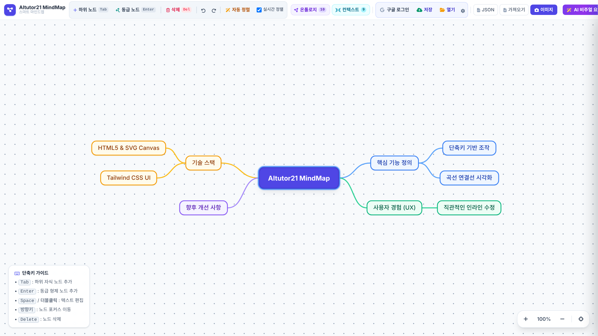
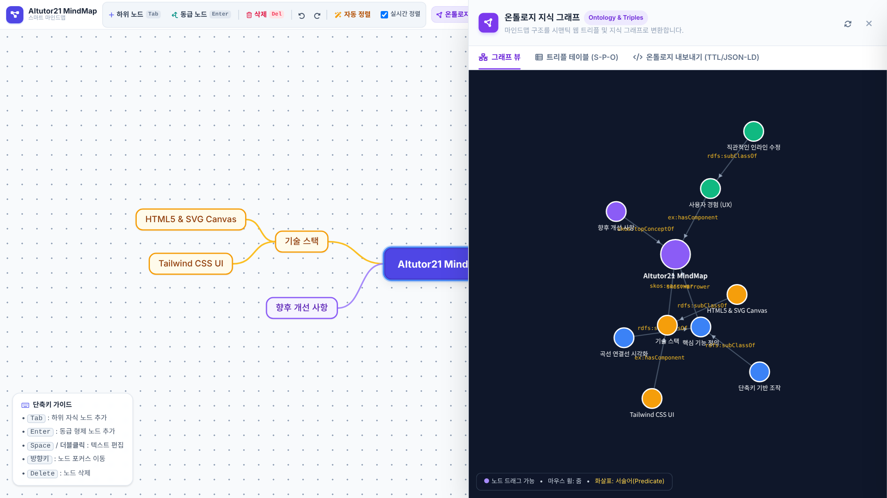

# AItutor21 MindMap

## 온톨로지 마인드맵 만들기 실습 5분 컷

마인드맵 → 온톨로지 → 엑셀 자동화 → AI 데이터분석

이 순서로 가면 AI가 헛소리 안 해요.

보안 공부용으로 만든 거라 보안 용어 정리할 때 특히 좋아요.

먼저 써보실 분들, 소스 여기요. 피드백 주면 강의에 반영할게요!

`#AI강의` `#보안` `#실습코드`

https://github.com/bryanshim/AItutor21-MindMap/

## 바로 써보기

설치 없이 아래 링크에서 바로 열어 쓸 수 있습니다.

- 마인드맵 써보세요 (클로드): https://claude.ai/artifact/SaRz7rTbYQJQRpCbkiFtbn
- 마인드맵 써보세요 (재미나이): https://share.gemini.google/N52Zm3dzL6Cm

## 5분 실습 순서

이 도구가 맡는 단계는 앞의 두 단계(마인드맵 → 온톨로지)입니다. 뒤의 두 단계(엑셀 자동화, AI 데이터분석)는 여기서 내보낸 결과를 가지고 강의에서 이어서 진행합니다.

1. `index.html`을 내려받아 브라우저에서 엽니다. 설치는 필요 없습니다.
2. 가운데 노드를 더블클릭해 주제를 적습니다. 예: `보안 용어`
3. `Tab`으로 하위 노드, `Enter`로 동급 노드를 추가하며 용어를 분류합니다. 예: `공격 기법` → `피싱`, `랜섬웨어` / `방어 기술` → `방화벽`, `EDR`
4. 상단의 `온톨로지` 버튼을 누릅니다. 마인드맵이 주어-서술어-목적어 트리플과 지식 그래프로 바뀐 것을 확인합니다.
5. `온톨로지 내보내기` 탭에서 Turtle, JSON-LD, Neo4j Cypher 중 하나를 복사하거나, 상단 `JSON` 버튼으로 맵 전체를 저장합니다. 이 결과가 다음 단계(엑셀 자동화, AI 데이터분석)의 입력이 됩니다.

참고: 트리플의 서술어는 노드 이름에 들어 있는 낱말(예: `스택`, `기능`, `UX`)을 보고 자동으로 정합니다. 실습용 규칙이므로 실제 온톨로지에 쓸 때는 서술어를 직접 검토해야 합니다.

## 피드백

써보시고 불편한 점이나 넣었으면 하는 기능은 이 저장소의 [Issues](https://github.com/bryanshim/AItutor21-MindMap/issues)에 남겨 주세요. 강의에 반영하겠습니다.

## 소개

단일 HTML 파일로 동작하는 마인드맵 편집기입니다. 설치 없이 `index.html`을 브라우저에서 열면 됩니다.

## 화면

마인드맵 편집 화면

온톨로지 지식 그래프

트리플(S-P-O) 표

컨텍스트 그래프

AI 비주얼 요약 (Claude·Gemini를 쓸 수 없을 때 나오는 요약 포스터)

## 파일

- `index.html` — 수정본 (아래 "원본 대비 수정 내역" 반영)
- `original/aitutor21_mindmap.html` — 원본 그대로
- `screenshots/` — 위 화면 캡처 (기본 예시 맵, 1440×810 창 기준)

## 기능

- 마인드맵 편집: Tab(하위 노드), Enter(동급 노드), Space/더블클릭(텍스트 편집), 방향키(이동), Delete(삭제), Ctrl+Z/Y(실행 취소/다시 실행)
- 자동 정렬, 확대/축소, 드래그 이동
- 온톨로지 패널: 트리플(S-P-O) 표, Turtle / JSON-LD / Neo4j Cypher 내보내기
- 컨텍스트 그래프 패널: 도메인별 분석, GraphRAG 청크 / Mermaid / JSON 내보내기
- JSON 저장·불러오기, PNG 내보내기
- Google Drive 저장·열기 (본인 OAuth Client ID 입력 필요)
- AI 비주얼 요약: 마인드맵 내용으로 그림 한 장 생성

## AI 비주얼 요약 동작 순서

1. Claude 게시 페이지에서 열린 경우: Claude가 마인드맵 내용으로 SVG 일러스트를 그립니다.
2. 그 외 환경에서 Gemini API 키를 입력한 경우: Gemini 이미지 모델을 호출합니다.
3. 둘 다 없으면: 마인드맵 내용을 좌우 카드로 정리한 요약 포스터를 캔버스로 그립니다.

API 키와 OAuth Client ID는 코드에 들어 있지 않으며, 사용자가 입력하면 브라우저 localStorage에만 저장됩니다.

## 원본 대비 수정 내역

- 요약 포스터가 마인드맵과 무관한 고정 도면을 그리던 문제 수정 → 마인드맵 내용만 그림
- Gemini 프롬프트의 고정 주제 문구 제거 → 마인드맵 내용만 사용하도록 지시
- Tailwind CDN 스크립트 제거 → Tailwind CLI 3.4.17로 미리 빌드한 CSS를 `<style>`로 포함 (CDN 경고 제거)
- 파일 저장(JSON, PNG, 포스터)을 공통 함수로 정리
- 파비콘 404 제거

## 알려진 문제

- Google Drive "열기"가 참조하는 `modal-gdrive-files`, `drive-files-list` 요소가 HTML에 없어, 로그인 후 열기를 누르면 오류가 납니다 (원본부터 있던 문제, 미수정).
- Tailwind 클래스를 새로 추가하면 CSS를 다시 빌드해야 적용됩니다.
- Gemini 호출 경로와 Google Drive 연동은 실제 키로 시험하지 않았습니다.
